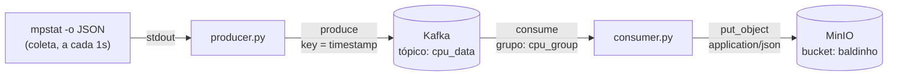

# telemetry-lake

Telemetria de CPU do host, coletada com `mpstat`, transportada por Kafka e
persistida como objetos JSON num data lake compatível com S3 (MinIO).
Tudo em containers, Kafka em modo KRaft — sem ZooKeeper.

[](https://www.python.org/)
[](https://kafka.apache.org/)
[](https://min.io/)
[](https://docs.docker.com/compose/)



## Por que este projeto existe

Amostrar a máquina é fácil; o interessante é atravessar um broker e chegar a um
object storage **sem duplicar dados**. Este repositório é uma fatia mínima, de
ponta a ponta, de um caminho real de ingestão:

- **Semântica de broker** — o Kafka como amortecedor entre um producer rápido e
  um destino mais lento.
- **KRaft** — Kafka de nó único sem ZooKeeper, configuração moderna.
- **Entrega at-least-once** — o timestamp é a *key* da mensagem **e** o nome do
  objeto, então uma reentrega sobrescreve o mesmo objeto em vez de duplicar.
- **Layout de objeto** — um documento JSON por amostra, pronto para ser lido por
  `jq`, DuckDB ou Athena.

## Pré-requisitos

- Docker + Docker Compose
- Python 3.9+ (testado em 3.13)
- `sysstat`, que fornece o `mpstat`:

```bash
sudo apt install sysstat   # Debian/Ubuntu
sudo dnf install sysstat   # Fedora
```

## Como rodar

```bash
python3 -m venv .venv && source .venv/bin/activate
pip install -r requirements.txt

docker compose up -d          # Kafka (KRaft) + MinIO
make produce                  # terminal 1: amostra a CPU a cada segundo
make consume                  # terminal 2: Kafka -> MinIO
```

O broker leva alguns segundos para aceitar conexões. Se o producer reclamar de
conexão, confira `docker compose ps` (o serviço `kafka` expõe um healthcheck) e
tente de novo.

Nenhum `.env` é necessário: todos os valores têm default de desenvolvimento.
Para trocar algo, veja [`Configuração`](#configuração).

## Como verificar

Console do MinIO em <http://localhost:9001> (usuário e senha padrão:
`minioadmin` / `minioadmin`). No bucket `baldinho`, deve aparecer um objeto novo
por segundo, com nome no formato:

```
cpu_2026-11-04T17-20-01Z.json
```

Abrindo um objeto, o conteúdo é o JSON do `mpstat` — não uma string com JSON
dentro:

```json
{"sysstat": {"hosts": [{"number-of-cpus": 8, "statistics": [...]}]}}
```

Também é possível inspecionar pela linha de comando:

```bash
mc alias set local http://localhost:9000 minioadmin minioadmin
mc ls local/baldinho | tail -3
mc cat local/baldinho/$(mc ls local/baldinho | tail -1 | awk '{print $NF}') | jq .sysstat.hosts[0]."number-of-cpus"
```

Para derrubar tudo: `make down`.

## Configuração

Copie `.env.example` para `.env` se quiser sobrescrever algum valor.

| Variável | Default | Usada por | Para quê |
|---|---|---|---|
| `KAFKA_BOOTSTRAP` | `localhost:9094` | producer, consumer | Listener `EXTERNAL` do broker |
| `KAFKA_TOPIC` | `cpu_data` | producer, consumer | Tópico de destino |
| `KAFKA_GROUP_ID` | `cpu_group` | consumer | Grupo de consumidores |
| `MINIO_ENDPOINT` | `localhost:9000` | consumer | Endpoint S3-compatible |
| `MINIO_ROOT_USER` | `minioadmin` | MinIO, consumer | Credencial |
| `MINIO_ROOT_PASSWORD` | `minioadmin` | MinIO, consumer | Credencial |
| `MINIO_BUCKET` | `baldinho` | MinIO, consumer | Bucket de destino |
| `SAMPLE_INTERVAL` | `1` | producer | Segundos entre amostras |

## Estrutura

```
.
├── compose.yaml            # Kafka (KRaft) + MinIO, imagens com tag fixa
├── makefile                # up / down / produce / consume / logs / bash
├── requirements.txt        # confluent-kafka, minio (versões fixas)
├── .env.example
└── src/
    ├── producer.py         # mpstat -> Kafka
    └── consumer.py         # Kafka -> MinIO
```

## Decisões de projeto

- **A key é o timestamp, não um UUID.** É o que torna a escrita idempotente: um
  reprocessamento aponta para o mesmo nome de objeto.
- **Um objeto por amostra**, em vez de escrita incremental. Object storage é
  imutável; criar objetos novos é mais barato e mais seguro que
  ler-modificar-escrever.
- **Dois listeners no Kafka** (`PLAINTEXT` para tráfego entre containers,
  `EXTERNAL` para o host), para o mesmo broker servir os dois lados.
- **At-least-once, não exactly-once.** O destino é idempotente, então um producer
  transacional seria complexidade sem ganho para telemetria.
- **Validação na borda.** A saída do `mpstat` é entrada externa: se não for JSON
  válido, a iteração é pulada em vez de publicar lixo no tópico.
- **Imagens com tag fixa** (`bitnamilegacy`) em vez de `latest`: um quickstart que
  depende do que o registry tem no dia não é reproduzível.

## Limitações e próximos passos

- [ ] Kafka sem volume persistente: `make down` zera os offsets
- [ ] Um objeto por segundo gera muitos arquivos pequenos — agrupar em janelas de
      5 minutos e gravar Parquet reduziria custo de listagem
- [ ] Particionamento Hive (`dt=AAAA-MM-DD/`) para consulta com Athena
- [ ] Testes automatizados do sampler e do sink
- [ ] CI (lint + testes) no GitHub Actions
